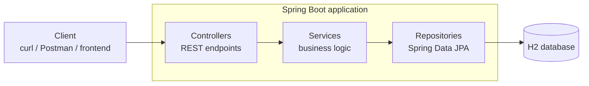
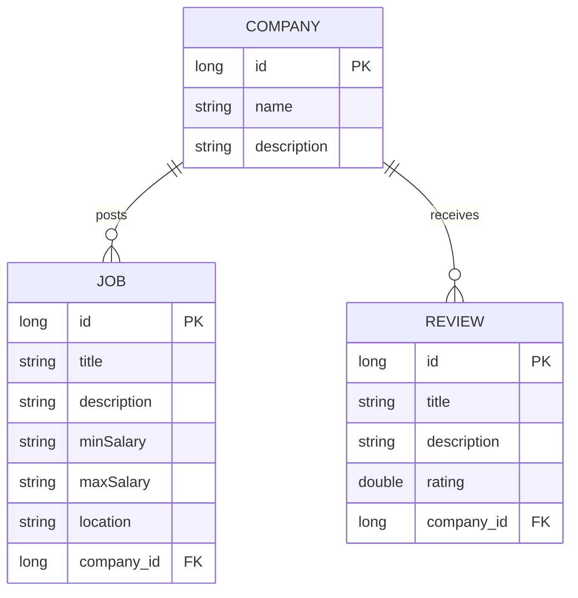

# Job Application Platform: Spring Boot REST API

A RESTful backend for managing **companies, job postings and company reviews**, built with **Java 21, Spring Boot 3 and Spring Data JPA**. It follows a clean layered architecture (controller → service → repository) and is organised by business domain, so each feature can later be split into its own service.


-1021FF)

---

## Overview

The API lets a client:

- **Create and manage companies**
- **Post and manage jobs**, each linked to a company
- **Add, read, update and delete reviews** for a company (with ratings)
- **Monitor the app** through Spring Boot Actuator (health, info, metrics)

It is a **modular monolith**: one deployable application, with three clearly separated domain packages (`company`, `job`, `review`). It is a good base to evolve into microservices (see the [Roadmap](#roadmap)).

---

## Tech stack

| Area | Technology |
|---|---|
| Language | Java 21 |
| Framework | Spring Boot 3.3.5 (Spring Web, Spring Data JPA) |
| Database | H2 in-memory (swap for PostgreSQL/MySQL for real use) |
| Build | Maven (Maven Wrapper included, no Maven install needed) |
| Monitoring | Spring Boot Actuator |
| Testing | Spring Boot Test (JUnit 5) |

---

## Architecture



### Data model



### Project structure

```
firstjobapp/
├── pom.xml
├── mvnw / mvnw.cmd                     # Maven Wrapper
└── src/
    ├── main/
    │   ├── java/com/embarkx/firstjobapp/
    │   │   ├── FirstjobappApplication.java
    │   │   ├── company/                # Company entity, controller, service, repository
    │   │   │   └── impl/CompanyServiceImpl.java
    │   │   ├── job/                    # Job entity, controller, service, repository
    │   │   │   └── impl/JobServiceImpl.java
    │   │   └── review/                 # Review entity, controller, service, repository
    │   │       └── impl/ReviewServiceImpl.java
    │   └── resources/
    │       └── application.properties
    └── test/
        └── java/com/embarkx/firstjobapp/FirstjobappApplicationTests.java
```

Each domain package follows the same pattern: **Entity**, **Controller**, **Service interface**, **Service implementation** (in `impl/`) and **Repository**. Controllers depend on service *interfaces*, which keeps the layers loosely coupled and easy to test.

---

## Getting started

### Prerequisites

- **JDK 21** (`java -version` should show 21)
- Git

No separate Maven installation is needed. Use the included wrapper.

### Run the application

```bash
git clone https://github.com/<your-username>/firstjobapp.git
cd firstjobapp

# Linux / macOS
./mvnw spring-boot:run

# Windows
mvnw.cmd spring-boot:run
```

The API starts on **http://localhost:8080**.

### Build a runnable JAR

```bash
./mvnw clean package
java -jar target/firstjobapp-0.0.1-SNAPSHOT.jar
```

### Run the tests

```bash
./mvnw test
```

---

## API reference

### Jobs: `/jobs`

| Method | Endpoint | Description |
|---|---|---|
| `GET` | `/jobs` | List all jobs |
| `GET` | `/jobs/{id}` | Get one job |
| `POST` | `/jobs` | Create a job |
| `PUT` | `/jobs/{id}` | Update a job |
| `DELETE` | `/jobs/{id}` | Delete a job |

### Companies: `/companies`

| Method | Endpoint | Description |
|---|---|---|
| `GET` | `/companies` | List all companies |
| `GET` | `/companies/{id}` | Get one company |
| `POST` | `/companies` | Create a company |
| `PUT` | `/companies/{id}` | Update a company |
| `DELETE` | `/companies/{id}` | Delete a company |

### Reviews: `/companies/{companyId}/reviews`

| Method | Endpoint | Description |
|---|---|---|
| `GET` | `/companies/{companyId}/reviews` | List a company's reviews |
| `GET` | `/companies/{companyId}/reviews/{reviewId}` | Get one review |
| `POST` | `/companies/{companyId}/reviews/` | Add a review (**note the trailing slash**) |
| `PUT` | `/companies/{companyId}/reviews/{reviewId}` | Update a review |
| `DELETE` | `/companies/{companyId}/reviews/{reviewId}` | Delete a review |

### Example requests

**Create a company**

```bash
curl -X POST http://localhost:8080/companies \
  -H "Content-Type: application/json" \
  -d '{"name": "Acme Corp", "description": "Software and consulting"}'
```

**Create a job linked to that company**

```bash
curl -X POST http://localhost:8080/jobs \
  -H "Content-Type: application/json" \
  -d '{
        "title": "Backend Engineer",
        "description": "Build Spring Boot services",
        "minSalary": "70000",
        "maxSalary": "95000",
        "location": "Remote",
        "company": { "id": 1 }
      }'
```

**Add a review**

```bash
curl -X POST http://localhost:8080/companies/1/reviews/ \
  -H "Content-Type: application/json" \
  -d '{"title": "Great culture", "description": "Supportive team", "rating": 4.5}'
```

**Read it back**

```bash
curl http://localhost:8080/companies/1/reviews
```

---

## Monitoring and tools

| URL | What it is |
|---|---|
| `/actuator/health` | Application health (with details) |
| `/actuator/info` | App name, description, version |
| `/actuator` | All exposed Actuator endpoints |
| `/h2-console` | Browser-based database console |

For the H2 console use the JDBC URL `jdbc:h2:mem:test`, user `sa`, and an empty password.

> **Development settings only.** The default config exposes *all* Actuator endpoints and enables the shutdown endpoint. Restrict these before any real deployment. See [Roadmap](#roadmap).

---

## Key concepts demonstrated

- RESTful API design with proper HTTP status codes (`200`, `201`, `404`)
- Layered architecture with constructor-based dependency injection
- JPA entity relationships (`@OneToMany` / `@ManyToOne`) and Spring Data derived queries (`findByCompanyId`)
- Handling circular JSON references with `@JsonIgnore`
- Nested REST resources (`/companies/{id}/reviews`)
- Production-style features: Actuator, graceful shutdown, externalised configuration

---

## Known limitations

This is a learning project. These are the gaps I know about and would address next:

- **In-memory database:** all data is lost on restart.
- **No input validation:** requests are not checked for missing or invalid fields.
- **Entities exposed directly:** there are no DTOs separating the API model from the database model.
- **Basic error handling:** there is no global exception handler or structured error response.
- **Salaries stored as strings:** they should be numeric types.
- **Light test coverage:** only a context-load test exists today.
- **No authentication or authorization.**
- **Open Actuator endpoints** (including shutdown) are fine locally but unsafe in production.

---

## Roadmap

- [ ] Add a global exception handler and request validation (`@Valid`)
- [ ] Introduce DTOs (for example with MapStruct)
- [ ] Unit tests (Mockito) and integration tests (`@WebMvcTest`, `@DataJpaTest`, Testcontainers)
- [ ] Switch to PostgreSQL with Flyway migrations
- [ ] Add Spring Security with JWT
- [ ] OpenAPI / Swagger documentation (`springdoc-openapi`)
- [ ] Dockerfile and `docker-compose.yml`
- [ ] CI with GitHub Actions (build + test on every push)
- [ ] Lock down Actuator endpoints
- [ ] **Split into microservices:** separate `company-service`, `job-service` and `review-service`, with an API gateway, service discovery and inter-service communication

---

## Author

**Your Name**
[LinkedIn](www.linkedin.com/in/rajeswarreddy-pondugula) · [GitHub](https://github.com/Rajeswarrddy)
